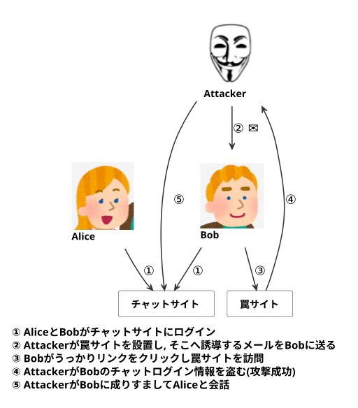

# BadChat -- XSS セッションハイジャック ハンズオン

## 概要

BadChat は**意図的に脆弱性を埋め込んだ**リアルタイムチャットアプリケーションです。
攻撃者が Reflected XSS を利用してセッション Cookie を窃取し、被害者になりすます一連の流れを体験できます。



### 学習目標

- Reflected XSS の仕組みと危険性を理解する
- セッションハイジャック攻撃の流れを体験する
- 適切な対策方法（出力エスケープ、HttpOnly Cookie 等）を学ぶ

## アーキテクチャ

```
┌─ブラウザ──────────────────────────────┐
│ badchat.example.com      :8100 (HTTP) │
│ ws.badchat.example.com   :8100 (WS)   │
│ trap.badchat.example.com :8100 (HTTP) │
└───────────────┬───────────────────────┘
                │
┌───────────────▼───────────────────────┐
│ nginx (リバースプロキシ)               │
├───────────────┬───────────────────────┤
│ PHP-FPM 8.3   │ WebSocket (Node.js)   │
│ チャット画面  │ メッセージ中継         │
│ ログイン処理  │                       │
├───────────────┘                       │
│ front-end ネットワーク                │
├───────────────────────────────────────┤
│ back-end ネットワーク                 │
├───────────────────────────────────────┤
│ MySQL 8.0     │ Adminer (:8180)       │
│ ユーザー管理  │ DB管理UI              │
└───────────────┴───────────────────────┘
```

ネットワーク構成図: [chat/diagrams/network.puml](../diagrams/network.puml)

## 前提条件

- WSL2（Ubuntu 等）
- Docker Engine（WSL2 上にインストール。Docker Desktop は使いません）
- VS Code + 拡張機能 WSL / Dev Containers（Dev Container で作業する場合）
- Google Chrome（Windows 側で実行）

> **注意**: リポジトリは **WSL のファイルシステム内**（例: `~/multi-hole-cheese`）に clone し、
> `docker compose` コマンドはすべて **WSL 上**で実行してください。
> ブラウザは **Windows 側**で開きます（WSL2 のポートは自動的に Windows へ転送されます）。

## セットアップ

### 1. ホスト名の解決について

`badchat.example.com` などのホスト名は、ハンズオン用の Chrome を起動するスクリプト
[launch_chrome.ps1](launch_chrome.ps1) が `--host-resolver-rules` で `127.0.0.1` に向けます。
**Windows の hosts ファイルを編集する必要はありません**（このスクリプトで起動した Chrome にだけ効きます）。

> 他のブラウザを使う場合は、代わりに `C:\Windows\System32\drivers\etc\hosts` に
> `127.0.0.1 badchat.example.com ws.badchat.example.com trap.badchat.example.com` を追記してください（管理者権限が必要）。

### 2. 環境変数の設定（任意）

Cookie 窃取の通知先として Slack を使う場合（WSL 上で実行）:

```bash
cp .env.sample .env
# .env を編集して SLACK_CHANNEL_ID と SLACK_APP_TOKEN を設定
```

### 3. コンテナの起動

次のどちらかで起動します。

#### A. VS Code の Dev Container で起動する（推奨）

1. WSL 上でリポジトリのルートを VS Code で開く: `code ~/multi-hole-cheese`
2. コマンドパレットから「Dev Containers: Reopen in Container」を実行し、`badchat` を選ぶ

`chat/bad/docker-compose.yml` の全サービスに加えて、作業用の `workspace` コンテナが WSL の Docker 上で起動し、VS Code はそのコンテナに接続します。
VS Code のウィンドウを閉じるとコンテナも停止します。

- ターミナルでは `curl http://badchat.example.com/` のように、ブラウザと同じホスト名でアクセスできます（コンテナ内ではポート指定は不要です）
- 「タスクの実行」から `app: logs` / `app: mysql` / `app: php lint` などを使えます
- SQLTools 拡張に DB 接続 `badchat db` が登録されています

#### B. WSL のターミナルで起動する

```bash
cd chat/bad
docker compose up -d
```

### 4. 動作確認

Windows の PowerShell で `launch_chrome.ps1` を実行して Chrome を起動します。

```powershell
# 例: \\wsl$\Ubuntu\home\<user>\multi-hole-cheese\chat\bad\launch_chrome.ps1
powershell -ExecutionPolicy Bypass -File .\launch_chrome.ps1
```

- チャットアプリ: http://badchat.example.com:8100
- DB管理: http://localhost:8180

テスト用アカウント:

| ユーザー名 | パスワード |
| ---- | ---- |
| alice | password1 |
| bob | password2 |

---

## ハンズオン

### Step 1: 正常な操作を体験する

1. `launch_chrome.ps1` で起動した 1 つ目の Chrome で http://badchat.example.com:8100 にアクセス
2. `alice` / `password1` でログイン
3. チャットルームでメッセージを送信してみる
4. 2 つ目の Chrome（別プロファイル）で `bob` でもログインし、会話できることを確認

### Step 2: XSS 脆弱性を確認する

ログイン済みの状態で、以下の URL に直接アクセスしてください:

```
http://badchat.example.com:8100/index.php?name=<script>alert(document.cookie)</script>
```

**結果**: アラートダイアログにセッション Cookie（`PHPSESSID=...`）が表示されます。

#### なぜ動くのか?

`index.php` の 31 行目で GET パラメータをそのまま出力しています:

```php
// 脆弱なコード
echo $_GET['name'];
```

`<script>` タグがエスケープされずに HTML に埋め込まれるため、任意の JavaScript が実行されます。

### Step 3: 攻撃シナリオを体験する

攻撃の全体像は [chat/diagrams/scenario.puml](../diagrams/scenario.puml) を参照してください。

1. `alice` でログインした状態を維持
2. 同じ Chrome の別タブで罠サイトにアクセス: http://trap.badchat.example.com:8100
3. 罠サイトは偽の Amazon ページを表示し、裏で隠し iframe 経由で XSS を実行
4. `alice` の `PHPSESSID` が罠サイトのサーバーに送信される
5. （Slack 設定済みの場合）攻撃者の Slack に Cookie が通知される

#### 攻撃の流れ

```
被害者 → 罠サイト → 隠しiframe → BadChat (XSS発火) → Cookie窃取 → 攻撃者
```

### Step 4: 脆弱性一覧を確認する

| # | 脆弱性 | ファイル | 行 | 影響 |
|---|--------|---------|----|----|
| 1 | Reflected XSS | `html/badchat/index.php` | 31 | セッションハイジャック |
| 2 | 平文パスワード保存 | `db/initdb.d/02_insert_rows.sql` | - | パスワード漏洩 |
| 3 | 平文パスワード比較 | `html/badchat/login.php` | 43 | 上記と連動 |
| 4 | GET でユーザー名を渡す | `html/badchat/login.php` | 52 | XSS の起点 |
| 5 | CSRF トークン未検証 | `html/badchat/login.php` | 24 | CSRF 攻撃 |
| 6 | 出力未エスケープ | `html/badchat/login.php` | 79,88 | XSS |
| 7 | HttpOnly Cookie なし | `php-fpm/php.ini` | - | JS から Cookie 読取可能 |
| 8 | phpinfo() 公開 | `html/badchat/info.php` | - | サーバー情報漏洩 |
| 9 | WS メッセージ無制限 | `ws/server.js` | - | DoS |

---

## 修正版: chat/good

[chat/good/](../good/) ディレクトリに全脆弱性を修正したバージョンがあります。

### 起動方法

Dev Container の場合は、リポジトリのルートを開いて「Dev Containers: Reopen in Container」で `goodchat` を選びます。
chat/bad と同時に起動できます（別ウィンドウで開いてください）。

ターミナルの場合は WSL 上で実行してください:

```bash
cd chat/good
docker compose up -d
```

`chat/good/launch_chrome.ps1` で Chrome を起動し、http://goodchat.example.com:8101 にアクセスします（DB管理は http://localhost:8181）。
ホスト名が chat/bad と異なるので、Cookie が混ざることはありません。

### 修正内容 Before / After

#### 1. Reflected XSS の修正 (`index.php`)

```php
// Before (chat/bad)
echo $_GET['name'];

// After (chat/good)
echo htmlspecialchars($_SESSION['name'], ENT_QUOTES, 'UTF-8');
```

GET パラメータではなくセッションから取得し、`htmlspecialchars()` でエスケープ。

#### 2. パスワードのハッシュ化 (`login.php`)

```php
// Before
if ($datas['password'] == $row['password'])

// After
if (password_verify($datas['password'], $row['password']))
```

DB には bcrypt ハッシュで保存。`password_verify()` で検証。

#### 3. GET パラメータの排除 (`login.php`)

```php
// Before
header("location:index.php?name=" . $_SESSION["name"]);

// After
header("location:index.php");
```

ユーザー名はセッションに保存済みなので URL に含める必要なし。

#### 4. CSRF トークン検証 (`login.php`)

```php
// After: POST 処理の先頭に追加
checkToken();
```

```html
<!-- After: フォームに hidden フィールドを追加 -->
<input type="hidden" name="token" value="<?php echo $_SESSION['token']; ?>">
```

#### 5. 出力エスケープ (`login.php`)

```php
// Before
echo '<div class="alert alert-danger">' . $login_err . '</div>';

// After
echo '<div class="alert alert-danger">' . htmlspecialchars($login_err, ENT_QUOTES, 'UTF-8') . '</div>';
```

#### 6. HttpOnly Cookie (`php.ini`)

```ini
; After: php.ini に追加
session.cookie_httponly = 1
session.cookie_samesite = "Strict"
```

JavaScript から `document.cookie` で読み取れなくなる。

#### 7. phpinfo() の削除

`info.php` を削除。サーバー構成情報を外部に公開しない。

#### 8. WebSocket メッセージ長制限 (`server.js`)

```javascript
// After: 1000文字を超えるメッセージを拒否
if (msgStr.length > MAX_MESSAGE_LENGTH) return;
```

---

## クリーンアップ

WSL 上で実行してください:

```bash
# chat/bad
cd chat/bad
docker compose down -v

# chat/good
cd ../good
docker compose down -v
```

`-v` オプションでデータベースのボリュームも削除されます。
