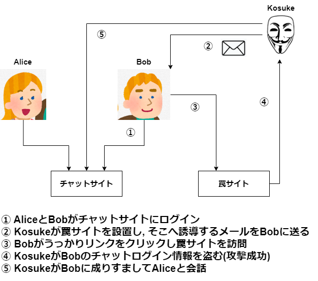
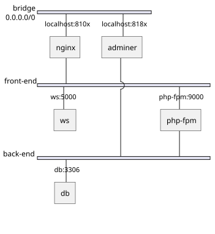

# GoodChat (chat/good)

[chat/bad](../bad/) の脆弱性をすべて修正したバージョンです。手順の詳細は [chat/bad/README.md](../bad/README.md) を参照してください。

## 攻撃のシナリオ



## ネットワーク図



## アクセス先

[launch_chrome.ps1](launch_chrome.ps1) で起動した Chrome からアクセスします（hosts ファイルの編集は不要）。

| 用途 | URL |
| ---- | ---- |
| チャット | http://goodchat.example.com:8101 |
| 罠サイト | http://trap.goodchat.example.com:8101 |
| DB管理 | http://localhost:8181 |

## Slack API の設定

`.env`

```
SLACK_CHANNEL_ID="XXXXX"
SLACK_APP_TOKEN="YYYYY"
```

## テスト用

- `http://goodchat.example.com:8101/index.php?name=%3Cscript%3Ealert(document.cookie)%3C/script%3E`
